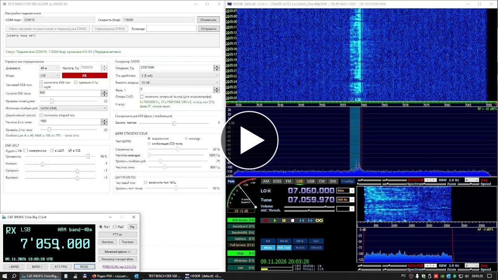
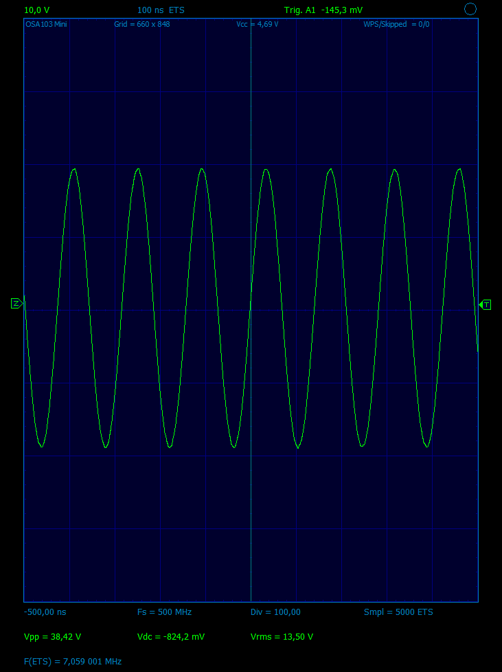
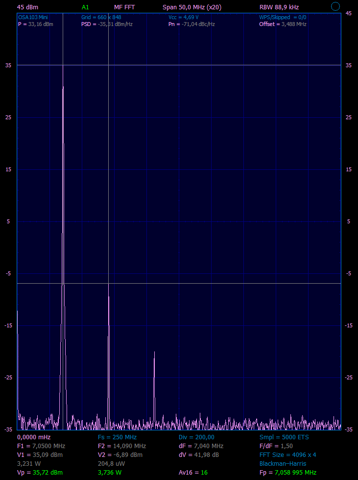
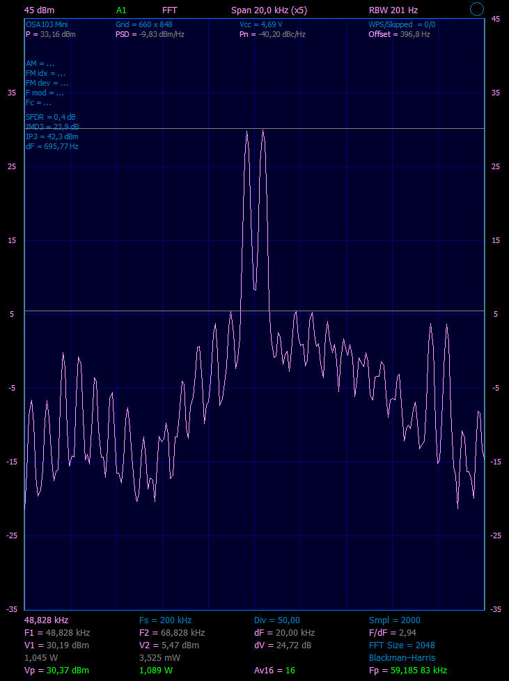
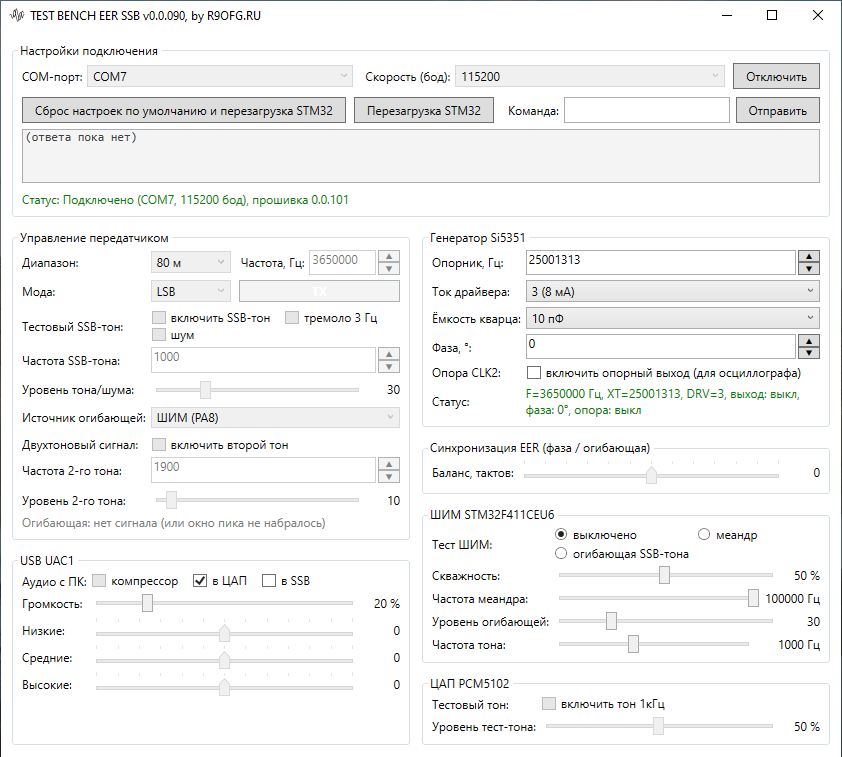

# Стенд QRP SSB-передатчика с полярным (EER) методом формирования SSB сигнала на STM32F411CEU6, Si5351, RD16HHF1

**Только передающий** (TX-only) QRP SSB-передатчик с полярной модуляцией (EER)
на STM32F411.


Идея взята от проекта uSDX: SSB формируется методом Канна (также известный как
метод разделения огибающей и фазы, Envelope Elimination and Restoration / EER) —
это эффективный полярный способ формирования и усиления однополосного (SSB)
радиосигнала. Огибающая и фаза складываются в выходном каскаде:

- **фаза** — синтезатор Si5351, перестраиваемый на каждом такте DSP
  (прямое цифровое формирование SSB);
- **амплитуда** — огибающая модулирует питание выходного каскада
  (Envelope Tracking), поэтому усилитель работает в классе E с высоким КПД.

[](https://youtu.be/X1-R08bXfMw)

*В роли SDR-приёмника с HDSDR используется [OSA103-mini](https://www.osa103.ru/); с 01:50 — запись звука с аналогового трансивера.*

[Принципиальная схема стенда, rev 1.1 (PDF)](Docs/Stend_EER_SSB_TX_rev1.1_RD16HHF1x1.pdf)

## Что скачать

Готовые файлы текущего релиза:

| Что | Файл | Версия |
|---|---|---|
| Прошивка (ST-LINK, `.hex`) | [`firmware/stend_polar_ssb_v0.0.101.hex`](firmware/stend_polar_ssb_v0.0.101.hex) | 0.0.101 |
| Прошивка (бинарный образ) | [`firmware/stend_polar_ssb_v0.0.101.bin`](firmware/stend_polar_ssb_v0.0.101.bin) | 0.0.101 |
| Приложение (Windows, zip) | [`app/TEST_BENCH_EER_SSB_UI_0.0.090.zip`](app/TEST_BENCH_EER_SSB_UI_0.0.090.zip) | 0.0.090 |

**Как залить прошивку.** Любым программатором ST-LINK (STM32CubeProgrammer,
ST-LINK Utility): файл `.hex` по адресу `0x08000000`, либо `.bin` туда же.
Настройки стенда (частота, уровни, эквалайзер и т. д.) хранятся в отдельном
секторе flash и перепрошивкой не затираются. После прошивки USB перечисляется
заново — номер COM-порта может измениться, а ключ стенда `#ID:PSSB-…`
сменится: приложение при подключении спросит про «другую прошивку», это
ожидаемо.

**Как запустить приложение.** Распаковать zip и запустить
`TEST_BENCH_EER_SSB_UI.exe` — среда .NET уже внутри, устанавливать ничего не
нужно. INI-файл настроек появится рядом с exe.

## Аппаратная часть

| Узел | Что используется |
|---|---|
| MCU | WeAct «Black Pill» STM32F411CEU6, HSE 25 МГц, SYSCLK 96 МГц, USB FS |
| Синтез | Si5351A: CLK0 — несущая передачи (фазовая модуляция), CLK2 — опорный выход для осциллографа |
| I²C | I2C1: PB6 = SCL, PB7 = SDA, **900 кГц** |
| Драйвер CLK0 | Si5351 3,3 В → 74ACT08 (3,3 → 5 В) → затвор RD16HHF1 класса E |
| Огибающая (ЦАП) | PCM5102 по I2S2 (PB12 = WS, PB13 = CK, PB15 = SD), 48 кГц |
| Огибающая (ШИМ) | PA8 = TIM1_CH1, **100 кГц, ARR 959**, полярность инвертирована (высокий уровень = ключ закрыт) |
| Модулятор питания | PA8 → TC4420 → IRF4905 (верхний ключ) → L 100 мкГн → 100 нФ + 4,7 мкФ → питание PA; ловящий диод SK36 |
| USB | составное устройство: UAC1 (звук) + CDC (CAT/PTT и сервисная консоль), VID/PID `0xCafe`/`0x40A1` |
| Управление | CAT — протокол Kenwood TS-480; поверх протокола — сервисные команды стенда |
| PA | class-E, 12–13,8 В: 3× BS170x2 (выходная мощность ~1W) или RD16HHF1 (выходная мощность ~4W) |
| Индикация | Светодиод на PC13 горит, пока идёт передача |

Диапазон 40 м, режимы LSB/USB. Без модуля Si5351 передача запрещена
(`TX;` отвечает `#ERR:NO_SI;`).

## Тракт DSP

Такт модулятора — **8000 Гц** (`SSB_SAMPLE_RATE_HZ`), бюджет такта 125 мкс.
Запись фазы в Si5351 — **неблокирующая** (`HAL_I2C_Mem_Write_IT`: передача идёт
прерыванием, такт не ждёт шину), состояние бюджета видно в `diag` (`TICK`,
`MT`, `MTA`, `MISS`, `LOOP`).

Порядок обработки одного отсчёта (`ssb_process()`):

1. **Вход**, один источник на такт: тест-тон (`ton`), двухтон (`t2`), шум
   (`nz`) или голос с ПК (`uac2`).
2. **Полоса**: усиление ×2 и биквад-ФВЧ Баттерворта **200 Гц** на FPU
   (CMSIS `arm_biquad_cascade_df1_f32`). Полоса системы — **200…2800 Гц**;
   общий коэффициент передачи в полосе 1,46 (это число привязано к
   калибровке `lev`).
3. **Аналитический сигнал**: линия задержки 16 отсчётов во `float32`;
   `i = v[7]·2`; `q` — 15-отводный Гильберт (коэффициенты 2/8/21/16,
   `/64`, плюс `v[6]−v[8]`) — тоже во `float32`.
4. **Огибающая**: `|z| = √((i/2)² + (q/2)²)` точным `arm_sqrt_f32`,
   сдвиг ×4 (`SSB_DRIVE`), ограничение 255.
   Компрессор речи (`cmp`) стоит в этой же точке, только на пути `uac2`.
5. **Фаза**: `arm_atan2_f32`, разворачивание скачка ±π, `df = Δφ·Fs/2π`
   в герцах со знаком; знак задаёт боковую полосу (USB/LSB).
6. **Выход**: сначала огибающая (CCR1 ШИМ и/или ЦАП), затем **запуск
   неблокирующей** передачи фазы в Si5351 (`HAL_I2C_Mem_Write_IT`; такт шину
   не ждёт). Порядок сохраняет смысл: амплитуда одного отсчёта фиксируется
   раньше, чем начинается передача фазы. Остаточный разбег компенсируется
   балансом `syn` (±6 тактов = ±750 мкс).

Огибающая выходит туда, куда указывает `env`: ЦАП PCM5102, ШИМ PA8 или оба
выхода сразу. ШИМ: `duty = amp·959/255`, несущая 100 кГц.

Входные пути (тон, шум, голос) считаются с округлением к ближайшему: усечение
на уровнях `lev` ~30 давало ошибку до 3 % амплитуды, а она превращалась в
рябь скважности и АМ-шум у несущей.

### Измеренные характеристики (прибор [OSA103-mini](https://www.osa103.ru/), [калькуляторы](https://r9ofg.ru/_content/calc/calculators.html))

Стенд RD16HHF1, 40 м, питание 12 В:

| Параметр | Значение |
|---|---|
| Выходная мощность | 3,6–3,7 Вт (Vrms 13,5 В) |
| КПД выходного каскада | 67,5 % (12 В × 0,45 А = 5,4 Вт подводимой при 3,645 Вт выходной) |
| Ток потребления | 0,45 А на передаче; 0,1 А без передачи |
| IMD3 (двухтон) | 19,2…23,0 дБ |
| IP3 | 40,2…42,3 dBm |
| 2-я гармоника (один тон) | ≈ −42 дБц |
| 3-я гармоника (один тон) | ≈ −58 дБц |
| Полоса SSB сигнала | 200…2800 Гц |
| Такт DSP | 8000 Гц (125 мкс на такт). Такт обязан быть целым делителем частоты USB-звука 48 кГц: 48 000 / 6 = 8000, 48 000 / 5 = 9600 (uSDX / 10 = 4800). Например 8600 нацело 48 000 не делит — дециматору пришлось бы брать дробное число отсчётов, это даёт периодическую ошибку. Из двух вариантов выше 9600 не проходит: на каждый такт приходится одна посылка в Si5351 (5 байт по 900 кГц, 55–60 мкс), на 9600 Гц шина занята почти всё время и такты пропускались — фактический такт падал до 8925 Гц, средняя работа такта (`MTA`) росла до ~90 мкс |







*На картинке — ИМД двухтона 800/1500 Гц.*

## Сервисные команды

Тот же COM-порт, что и CAT. **Голые слова (без `#`) набираются строчными** —
это и разводит сервисную консоль с CAT: хост пишет `ID;` прописными, и такая
строка уходит в CAT. Форма с `#` регистром не ограничена (`#ID`, `#id` — одно
и то же). Ответы консоли начинаются с `#`.

| Команда | Ответ | Описание |
|---|---|---|
| `help;` | `#HELP:…;` | список команд (из-за ограничения длины строки не все команды входят в терминальный вывод) |
| `ver;` / `rev;` | `#VER:x.x.xxx;` | версия прошивки |
| `id;` | `#ID:PSSB-x.x.xxx;` | ключ стенда; по нему приложение отличает свой стенд от чужого порта |
| `diag;` | `#DIAG:…;` | диагностика: `CLK/DIV/ODD/FS/MEAS/PLL` — I2S; `PWMD/PWMF/PWMA` — ШИМ; `MISS/LATE/ERR` — сбои и I²C; `TICK` — тактов DSP в секунду, `MT`/`MTA` — худший/средний такт, мкс; `LOOP` — худший проход главного цикла, мкс |
| `si;` | `#SI:OK;XT=…;DRV=…;F=…;OUT=…;PH=…;EFF=…;REF=…;` | состояние Si5351 (`OUT` — CLK0 на передаче, `PH`/`EFF` — запрошенная/достижимая фаза, `REF` — опора CLK2) |
| `sireg;` | `#SIREG:…;` | регистры Si5351, решающие выдачу сигнала |
| `sireg2;` | `#SIREG2:MS0=…;PLLA=…;` | блоки параметров MS0 и PLL A |
| `xtNNN;` | `#XT[NNN];` | частота кварца Si5351, 10…29 МГц (по умолчанию 25 000 000) |
| `drvN;` | `#DRV[N];` | ток драйвера CLK0: 0…3 → 2/4/6/8 мА (по умолчанию 3) |
| `xlNN;` | `#XL[NN];` | внутренняя нагрузочная ёмкость кварца Si5351: **6, 8 или 10 пФ** (регистр 183). На китайских модулях Si5351/MS5351M требуется замена кварца для стабильной работы, например «YXC 3225 25.000MHz» |
| `phNNN;` | `#PH[N];EFF=M;` | фаза CLK0, −180…+180°; достижимый угол зависит от делителя (`EFF`) |
| `ref0;` `ref1;` | `#REF[N];` | опорный выход CLK2 для осциллографа (в ОЗУ, после сброса выкл.) |
| `tonNNN;` | `#TON[N];F=NNN;` | тест-тон: `ton0`/`ton1` вкл/выкл, число — частота 100…2400 Гц (включает тон) |
| `tma0;` `tma1;` | `#TMA[N];` | тремоло 3 Гц (тест-тон «дышит»), в ОЗУ |
| `t20;` `t21;` | `#T2F[N];F=NNN;` | второй тон двухтонового сигнала |
| `t2fNNN;` | `#T2F[N];F=NNN;` | частота второго тона, 100…2400 Гц |
| `t2lNNN;` | `#T2L[N];` | уровень второго тона, 1…512 |
| `nz0;` `nz1;` | `#NZ[N];` | белый шум вместо тона (полоса ограничена 200…2800 Гц), в ОЗУ |
| `levNNN;` | `#LEV[N];A=…;MAX=…;` | уровень тона/шума 1…512 (флеш); `A` — мгновенная огибающая 0…255, `MAX` — её пик за окно |
| `env0;` `env1;` `env2;` | `#ENV[N];` | источник огибающей: 0 — ЦАП, 1 — ШИМ, 2 — оба (флеш, по умолчанию ШИМ) |
| `pcm0;` `pcm1;` | `#PCM[N];` | тестовый синус 1 кГц прямо на ЦАП (самотест PCM5102) |
| `ampNNNNN;` | `#AMP[N];` | амплитуда теста ЦАП, 0…32767 |
| `pwm0;` `pwm1;` `pwm2;` | `#PWM[N];` | тест ШИМ: 0 — выкл, 1 — меандр, 2 — огибающая SSB-тона (без PTT) |
| `pwaNNNNN;` | `#PWA[N];` | верхний уровень меандра, 0…32767 |
| `pwfNNNNN;` | `#PWF[N];` | частота меандра, 0…100000 Гц |
| `uvlNNN;` | `#UVL[N];` | громкость USB-аудио, 0…100 % (флеш) |
| `uac0;` `uac1;` `uac2;` | `#UAC:…;` | маршрут USB-звука: 0 — выкл, 1 — на ЦАП, 2 — в SSB (голос) |
| `eqlNN;` `eqmNN;` `eqhNN;` | `#EQ:L=…;M=…;H=…;` | эквалайзер голоса (низ/середина/верх), −12…+6 дБ (в приложении ±6) |
| `eq;` | `#EQ:L=…;M=…;H=…;` | запрос эквалайзера |
| `cmpN;` | `#CMP[N];` | компрессор речи: 0 — выкл, 1 — речь, 2 — радио (флеш) |
| `mon0;` `mon1;` `mon;` | `#MON[N];` | монитор состояния Si5351 раз в 0,5 с |
| `i2c;` | `#I2C[60,…];` | сканирование шины I²C |
| `def;` | `#DEF:OK;…;` | сброс настроек к заводским (без перезагрузки) |
| `rst;` `rst1;` | `#RST:OK;` | `rst` — заводские + перезагрузка, `rst1` — только перезагрузка; на передаче `#ERR:TX;`, при живом стриме `#ERR:BUSY;` |

## CAT (Kenwood TS-480)

Через CDC-порт; этого достаточно для WSJT-X, fldigi и любой программы на
hamlib. Настройки: **9600, 8N1, Handshake = None**, радио — Kenwood TS-480.
9600 — заводская скорость CAT у настоящего TS-480 (её же предлагает WSJT-X);
для USB CDC значение не имеет, подойдёт любая, но с ней настройки совпадают
с мануалом.

| Команда | Ответ | Примечание |
|---|---|---|
| `FA;` / `FA###########;` | `FA###########;` / `FA;` | частота VFO A |
| `FB;` / `FB###########;` | аналогично | частота VFO B |
| `MD;` / `MDn;` | `MDn;` | режим, 1 = LSB … 8 = FSK-R |
| `IF;` | 37 символов | блок состояния, раскладка ниже |
| `TX;` `TXn;` / `RX;` | `TX;` / `RX;` | PTT и светодиод; без Si5351 — `#ERR:NO_SI;` |
| `PS;` | `PS1;` | питание всегда «включено» |
| `ID;` | `ID020;` | модель TS-480 |
| `AI;` / `AI0;` | `AI0;` | авто-информация выключена |
| `TT;` | `TT;` | тюнер |

`IF;` — **ровно 37 символов** до `;` (столько ждёт hamlib, `if_len` = 37).

| Индексы | Содержимое |
|---|---|
| 0–1 | `IF` |
| 2–12 | частота, 11 цифр |
| 13–17 | заполнитель |
| 18–22 | сдвиг RIT/XIT, например `+0000` |
| 23 | RIT включён (читает hamlib) |
| 24 | XIT включён (читает hamlib) |
| 25–27 | заполнитель |
| 28 | PTT: `0` приём, `1` передача |
| 29 | режим (цифра Кенвуда) |
| 30 | VFO: `0` = A, `1` = B |
| 31 | заполнитель |
| 32 | split: `0` выключен |
| 33–36 | заполнитель |

Пример (14 074 000 Гц, USB, приём):

```
IF0001407400000000+000000000020000000;
```

## USB

Одно составное устройство `0xCafe`/`0x40A1`:

| № | Интерфейс | Назначение |
|---|---|---|
| 0 | Audio Control | UAC1 |
| 1 | Audio Streaming | моно, 16 бит, **48 кГц**, isochronous OUT, adaptive |
| 2–3 | CDC Control/Data | виртуальный COM-порт |

В Windows устройство определяется как **«STEND POLAR SSB Audio»**: «Динамики (STEND
POLAR SSB Audio)» и виртуальный COM-порт. Маршруты звука (`uac`):

- `uac0` — выключено (только подсчёт пакетов);
- `uac1` — звук с ПК прямо на ЦАП PCM5102 (проверка маршрута PC → UAC1 → DAC);
- `uac2` — голос с ПК в DSP вместо тест-тона: PC → SSB → эфир.

Любой тест-сигнал и `uac2` взаимоисключены — источник передачи всегда один.
Громкость обоих маршрутов — `uvl` (0…100 %, хранится во флеше, по умолчанию
10 %). На пути `uac2` дополнительно работают ФИР-децимация до такта DSP,
3-полосный эквалайзер и компрессор речи.

## Хранение настроек (config v12)

Сектор 7 flash по адресу `0x08060000`; перепрошивка `.bin` его не задевает
(только полное стирание или `def`/`rst`). Запись — CRC-16/Modbus, поля
проверяются по отдельности: одно испорченное поле заменяется своим
значением по умолчанию, остальные сохраняются.

| Поле | Смысл | По умолчанию |
|---|---|---|
| `xtal_hz` | частота кварца, 10…29 МГц | 25 000 000 |
| `drv_idx` | ток драйвера CLK0, 0…3 | 3 (8 мА) |
| `freq_hz` | последняя частота CAT | 14 074 000 |
| `mode` | последняя мода (код Кенвуда) | USB |
| `phase_deg` | фаза CLK0, −180…+180° | 0 |
| `env_route` | маршрут огибающей, 0/1/2 | 1 (ШИМ) |
| `tone_level` | `lev`, 1…512 | 10 |
| `sync` | `syn`, −6…+6 тактов | 0 |
| `uvl` | громкость USB, 0…100 % | 10 |
| `uac` | маршрут голоса в SSB, 0/1 | 0 (выкл) |
| `eq[3]` | эквалайзер, −12…+6 дБ на полосу | 0 |
| `cmp` | пресет компрессора, 0…2 | 0 (выкл) |
| `xl_pf` | ёмкость кварца Si5351, 6/8/10 пФ | 10 |

Частота, мода и прочие дискретные настройки пишутся сразу при простое; на
передаче и при живом звуковом потоке запись откладывается до тихого окна
(стирание сектора ~1 с останавливает CPU целиком). `def` и `rst` в этих
условиях отказывают: дефолты обязаны попасть во флеш до сброса.

## Приложение (Windows)

WPF, .NET 8, версия **0.0.090**.
Работает через тот же COM-порт: опрос состояния, настройки, CAT-команды.



**Минимальные требования:** Windows 10/11 x64; свободный USB-порт (CDC и UAC1
используют штатные драйверы Windows — доустанавливать ничего не нужно); окно
не меньше 400×260 (меньше приложение не даст); около 200 МБ свободного места
на диске (сам exe ~72 МБ, при старте Windows распаковывает его во временную
папку). Устанавливать .NET не нужно — среда уже внутри exe.

Приложение поставляется одним файлом (`self-contained`, сжатый single-file):
распаковать zip и запустить `TEST_BENCH_EER_SSB_UI.exe`. INI-файл настроек
создаётся рядом с exe; при переносе в другую папку настройки переедут вместе
с ним.

| Блок | Что умеет |
|---|---|
| Настройки подключения | порт и скорость, подключение, произвольная команда с журналом ответов, перезагрузка стенда, авто-переподключение |
| Управление передатчиком | диапазон и частота, мода, кнопка TX (зелёная в покое, красная на передаче), тест-тон с частотой и уровнем, второй тон, шум, тремоло, источник огибающей, строка `A`/`MAX` |
| USB UAC1 | галки «в ЦАП» / «в SSB» / «компрессор», громкость `uvl`, трехполосный эквалайзер |
| Генератор Si5351 | опорник, ёмкость кварца (6/8/10 пФ), ток драйвера, фаза, опорный выход CLK2, статус |
| Синхронизация EER | баланс `syn` |
| ШИМ STM32F411CEU6 | три режима теста (выкл / меандр / огибающая SSB-тона), скважность и частота меандра, зеркала уровня и частоты тона |
| ЦАП PCM5102 | тестовый синус и его амплитуда |

Настройки приложения хранятся в INI рядом с исполняемым файлом; настройки
стенда — во флеше МК (см. выше), приложение их читает, а не навязывает.
Порт опрашивается на предмет появления/пропажи, при обрыве связи идёт
автопереподключение. Подсказка по выбранному элементу показывается внизу
окна, в блоке «Комментарий».

## Ограничения

- Только передача; приёмник отдельный.
- Без модуля Si5351 передача невозможна (`#ERR:NO_SI;`).
- Такт DSP 8000 Гц; бюджет такта почти весь занят обработкой и передачей
  фазы в Si5351, дальнейшее усложнение DSP требует контроля `diag` (`MT`,
  `MTA`).
- 15-отводный Гильберт имеет собственный разбаланс амплитуд 1–3 % — это
  остаточная рябь огибающей; на слух и по IMD незаметна.
- Windows кэширует имя USB-устройства: после переименования устройство надо
  удалить и просканировать шину заново.

## Лицензия

Прошивка и приложение — готовые сборки для личного, **некоммерческого**
использования; коммерческое использование и распространение изменённых сборок
возможно только с согласия автора. Схемы и документация — для повторения и
некоммерческого использования; при публикации просьба ссылаться на этот
проект. Полный текст — в [LICENSE](LICENSE).
